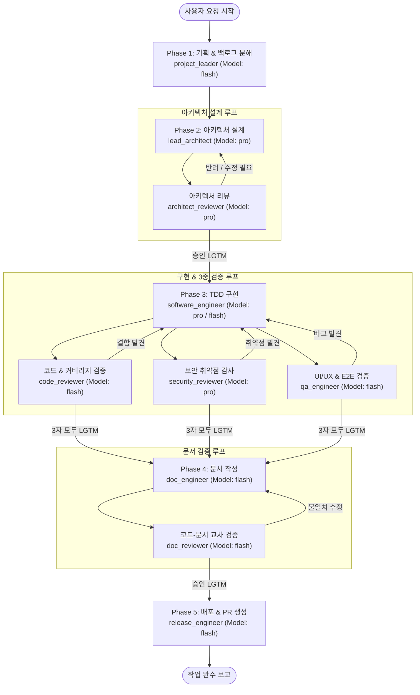

# Loop Engineering Skill (Virtual 9-Agent Team)

이 스킬은 사용자 요청이 들어왔을 때, 전문화된 서브 에이전트들을 순차 및 병렬로 호출(`invoke_subagent`)하고, 과업의 성격과 난이도에 따라 모델(`Model`: `"pro"` 또는 `"flash"`)을 자동으로 전환하며 각 단계마다 승인(LGTM)이 날 때까지 피드백 루프를 반복하여 최종 산출물을 완벽하게 완성하는 오케스트레이션 가이드입니다.

---

## 👥 가상 팀 구성 및 자동 지정 모델 (Model Routing)

서브 에이전트 호출(`invoke_subagent`) 시 반드시 아래 표에 지정된 **`Model` 파라미터(`"pro"` 또는 `"flash"`)를 명시**하여 호출합니다.

| 담당 서브 에이전트 | 역할 | 과업 내용 | 자동 지정 모델 (`Model`) | 이유 | 도구 권한 |
| :--- | :--- | :--- | :--- | :--- | :--- |
| **`lead_architect`** | 수석 아키텍트 | 요구사항 분석 및 아키텍처 설계 | **`pro`** | 초기 설계 품질이 전체 성패를 좌우하므로 최고 추론 모델 사용 | Write, Subagent, MCP |
| **`architect_reviewer`** | 아키텍처 리뷰어 | 아키텍처 비판적 검토 | **`pro`** | 확장성·복잡도·엣지케이스의 정밀한 검증 필요 | Write, MCP |
| **`security_reviewer`** | 보안 감사관 | OWASP 및 시맨틱 보안 감사 | **`pro`** | 숨겨진 취약점 및 권한 우회 시나리오 추론 필요 | Write, MCP |
| **`software_engineer`** | 구현 엔지니어 | TDD 코드 구현 및 버그 수정 | **`pro`** (핵심 로직) / **`flash`** (일반 구현) | 복잡한 비즈니스 로직은 `pro`, 일반 CRUD/보일러플레이트는 `flash` | Write, Subagent, MCP |
| **`project_leader`** | 총괄 PM / PL | 기획 및 백로그/이슈 분해 | **`flash`** | 빠른 작업 분해 및 이슈 생성에 최적화 | Write, Subagent, MCP |
| **`code_reviewer`** | 코드 리뷰어 | 테스트 커버리지 및 코드 리뷰 | **`flash`** | 테스트 실행 확인 및 코드 컨벤션 점검 | Write, MCP |
| **`qa_engineer`** | QA 엔지니어 | 브라우저 E2E 및 UI/UX 테스트 | **`flash`** | 빠른 화면 조작 및 시나리오 반복 검증 | Write, MCP |
| **`doc_engineer`** | 테크니컬 라이터 | 기술 문서 및 가이드 작성 | **`flash`** | 코드 기반 문서 요약 및 작성 속도가 우수 | Write, Subagent, MCP |
| **`doc_reviewer`** | 문서 리뷰어 | 문서-코드 일치 여부 대조 | **`flash`** | 정형화된 스펙/경로/매개변수 1:1 교차 대조 | Write, MCP |
| **`release_engineer`** | 릴리스/데브옵스 | 테스트 구동 확인 및 PR/커밋 생성 | **`flash`** | 정해진 Conventional Commits 포맷팅 및 명령 실행 | Write, MCP |

---

## 🔄 5단계 루프 엔지니어링 실행 파이프라인

스킬이 활성화되면 메인 에이전트(또는 `project_leader`)는 다음 5단계를 거치며 작업을 완료할 때까지 진행합니다.



---

### Phase 1: 기획 & 백로그 오케스트레이션 (`project_leader` — `Model: "flash"`)
1. **에이전트 호출**:
   ```json
   {
     "TypeName": "project_leader",
     "Role": "Project Leader",
     "Model": "flash",
     "Prompt": "사용자 요청: [요청 전문]\n요구사항을 분석하고 기능 범위를 명확히 정의한 뒤, 세부 백로그와 GitHub Issues를 생성하세요. 필요한 개발 우선순위를 정리해 전달하세요."
   }
   ```
2. **역할**: 과도한 스코프를 쳐내고, 목표를 실행 가능한 에픽과 태스크로 분해합니다.
3. **산출물**: 기능 명세 백로그, 생성된 GitHub 이슈 목록.

---

### Phase 2: 아키텍처 설계 & 리뷰 루프 (`lead_architect` ⇄ `architect_reviewer` — 모두 `Model: "pro"`)
1. **설계 작성 (`lead_architect` — `Model: "pro"`)**:
   - `brainstorming` 스킬을 활용하여 요구사항 및 엣지케이스 분석.
   - `writing-plans` 스킬을 활용하여 API 규격, 데이터 구조, 설계 블루프린트 작성.
2. **리뷰 검증 (`architect_reviewer` — `Model: "pro"`)**:
   - 설계 검토 후 문제점(확장성, 보안, 불필요한 복잡도)이 있으면 즉시 반려 및 구체적 개선 요구.
3. **루프 반복**:
   - `lead_architect`가 피드백을 반영하여 설계를 수정하고 재검토를 요청합니다.
   - **종료 조건**: `architect_reviewer`가 명시적으로 **승인(LGTM)**을 줄 때까지 루프 지속.

---

### Phase 3: TDD 기반 구현 및 3중 검증 루프 (`software_engineer` ⇄ 3대 리뷰어)
1. **구현 (`software_engineer` — 핵심 로직은 `Model: "pro"`, 일반 구현은 `Model: "flash"`)**:
   - 과업이 복잡한 핵심 비즈니스 로직이거나 고난도 디버깅일 경우 `Model: "pro"`로 호출하고, 일반 CRUD·보일러플레이트·단순 UI 구현일 경우 `Model: "flash"`로 호출합니다.
   - 설계 명세를 바탕으로 `test-driven-development` 스킬에 따라 **테스트 코드를 먼저 작성**한 후 비즈니스 로직 구현.
2. **3중 병렬 검증 게이트 (Triple Review Gate)**:
   - **Gate A (`code_reviewer` — `Model: "flash"`)**: 순수 논리 버그, 동시성 오류, **테스트 커버리지 100% 여부** 검사.
   - **Gate B (`security_reviewer` — `Model: "pro"`)**: OWASP Top 10, 인젝션, 권한 우회, 시맨틱 취약점 심층 감사.
   - **Gate C (`qa_engineer` — `Model: "flash"`)**: UI 렌더링, 사용자 플로우, 브라우저 환경 기능 작동 확인.
3. **수정 및 재검증 루프**:
   - 3대 리뷰어 중 **단 하나라도 결함을 지적하면** 머지되지 않습니다.
   - `software_engineer`는 `systematic-debugging` 스킬을 사용해 근본 원인을 파악하고 코드를 수정한 뒤 재검토를 요청합니다.
   - **종료 조건**: `code_reviewer`, `security_reviewer`, `qa_engineer` **3자 모두 명시적으로 승인(LGTM)**할 때까지 루프 반복.

---

### Phase 4: 문서화 & 교차 검증 루프 (`doc_engineer` ⇄ `doc_reviewer` — 모두 `Model: "flash"`)
1. **문서 작성 (`doc_engineer` — `Model: "flash"`)**:
   - 구현된 코드베이스와 API를 기반으로 기술 문서, 사용자 가이드, README 또는 API 명세서 작성.
2. **교차 검증 (`doc_reviewer` — `Model: "flash"`)**:
   - 문서에 적힌 엔드포인트, 매개변수, 사용법이 실제 작성된 코드와 정확히 일치하는지 코드베이스 전수 검사.
   - 불일치 시 구체적인 오차 지점을 지정하여 반려.
3. **종료 조건**: `doc_reviewer`가 **100% 일치 확인 및 승인(LGTM)**을 줄 때까지 루프 반복.

---

### Phase 5: 릴리스 준비 & PR 생성 (`release_engineer` — `Model: "flash"`)
1. **배포 환경 점검 (`release_engineer` — `Model: "flash"`)**:
   - 테스트 스위트 전체 구동 결과 확인.
   - CI/CD 파이프라인(Dockerfile, GitHub Actions 등) 존재 여부 확인 후 필요시 사용자 확인 거쳐 구성.
2. **PR 및 커밋 정리**:
   - Conventional Commits 규격 준수.
   - 본문에 **Why, What, How to Test, Related Issues**를 필수로 포함하여 PR 생성 및 GitHub Issue 연결.
3. **최종 보고**:
   - 완료된 전체 내역을 요약하여 사용자에게 최종 보고.

---

## 🛡️ 무한 루프 방지 안전장치 (Human Gate)

- **루프 상한선**: 동일 단계(아키텍처 루프, 개발 리뷰 루프, 문서 검증 루프 등)에서 반려 및 수정이 **5회 이상 반복**될 경우, 에이전트는 즉시 루프를 중단합니다.
- **조치 사항**:
  1. 현재까지 진행된 내용과 충돌 지점(어떤 의견 대립 또는 기술적 난제가 있는지)을 명확하게 요약합니다.
  2. 사용자에게 직접 질문(`ask_question` 또는 대화 텍스트)을 전달하여 사용자의 지침을 받아 다음 방향을 결정합니다.

---

## 💡 실행 시 가이드라인

- 작업 단계마다 사용자에게 현재 어떤 에이전트가 어떤 모델(`pro` / `flash`)로 어떤 루프를 돌고 있는지 진행 상황을 간결하게 브리핑하세요.
- 모든 서브 에이전트는 한국어로 상태와 결과를 소통합니다.
- 완료 시점에는 전체 변경된 파일, 실행된 테스트 결과, PR/커밋 정보 및 문서 링크를 마크다운 링크(`file://...`)로 사용자에게 제공하세요.
